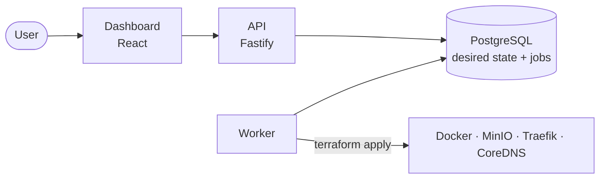

# Mini Cloud

A small, self-hosted cloud platform built from scratch on servers I control: compute, networking, storage and provisioning, with no AWS, Azure or GCP underneath.

Open the dashboard, click **Create server**, and a real server starts on infrastructure the platform controls. Later: buckets, databases, private networks, load balancers, users and permissions, monitoring, billing, functions, and real virtual machines on dedicated servers.

> **Status:** prototyping the building blocks (containers, resource limits, networks, volumes, Terraform). Platform code starts with Milestone 1. See the [roadmap](#roadmap).

## How it works

The **control plane** (dashboard, API, worker, database) decides what should exist. The **data plane** (Docker, MinIO, Traefik…) runs it. The worker turns each request into a Terraform run. Details in [ARCHITECTURE.md](docs/ARCHITECTURE.md).

## Stack

TypeScript · Node.js · Fastify · Zod · Drizzle · PostgreSQL · React · Vite · Mantine · Terraform · Docker · Traefik · MinIO

Full list and reasons: [TECH-STACK.md](docs/TECH-STACK.md).

## Documentation

| Document                                     | What's in it                                                                                |
| -------------------------------------------- | ------------------------------------------------------------------------------------------- |
| [docs/ARCHITECTURE.md](docs/ARCHITECTURE.md) | How it's built: components, request flow, data model, config, security                      |
| [docs/BACKEND.md](docs/BACKEND.md)           | API and worker inside: layers, endpoints, errors, job loop, Terraform runner                |
| [docs/FRONTEND.md](docs/FRONTEND.md)         | Dashboard inside: folders, routes, data layer, live updates, forms, UI rules                |
| [docs/CAPACITY.md](docs/CAPACITY.md)         | Server sizes, host sizing formula, capacity check, host configuration                       |
| [docs/INFRA.md](docs/INFRA.md)               | How Node drives the network and subsystems: network layout, IP plan, Traefik, DNS, firewall |
| [docs/TECH-STACK.md](docs/TECH-STACK.md)     | Every technology, its version and why                                                       |
| [docs/adr/](docs/adr/README.md)              | Architecture decision records                                                               |

## Roadmap

| Phase |                                                      | Milestone                      |
| ----- | ---------------------------------------------------- | ------------------------------ |
| 0     | Environment setup                                    |                                |
| 1     | Prototypes: containers, networks, storage, Terraform |                                |
| 2     | First version: one button, one server                | **M1 — It works**              |
| 3     | Make it solid                                        |                                |
| 4     | More services                                        | **M2 — It looks like a cloud** |
| 5     | Users, projects, permissions                         |                                |
| 6     | Monitoring and metering                              |                                |
| 7     | Move to a rented server                              | **M3 — It is online**          |
| 8     | Application services                                 |                                |
| 9     | Dedicated servers and real VMs                       | **M4 — It runs real machines** |
| 10    | Scale and choose a direction                         |                                |

## Quick start

_Filled in at the end of Phase 2._

## Engineering principles

1. Prototype each building block manually before automating it.
2. One ticket in progress at a time. Done means every acceptance box is ticked.
3. Break it on purpose (failure testing), then fix it.
4. Desired state lives in the database; generated config is never edited manually.
5. Every significant decision gets an ADR.
