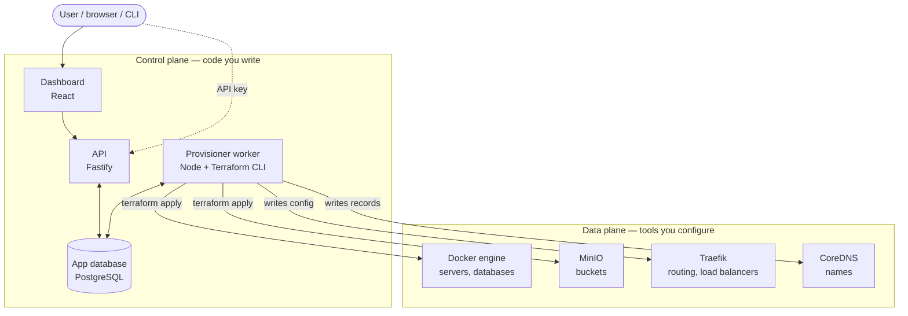
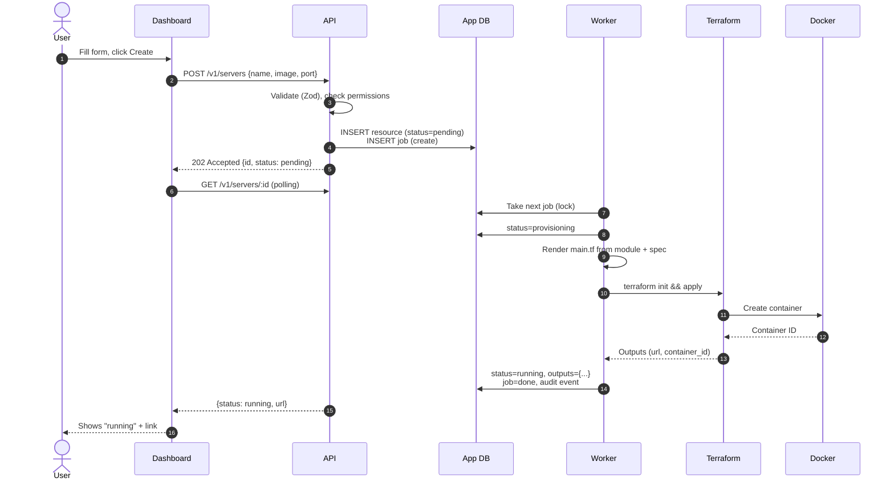
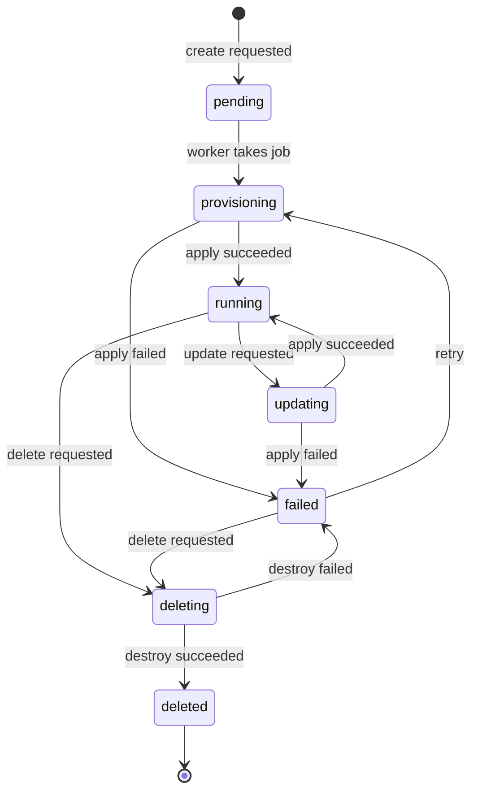
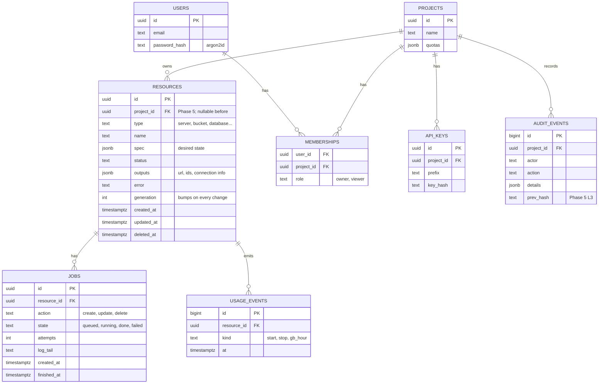

# Mini Cloud — Architecture

| | |
|---|---|
| Status | Draft v1 |
| Last updated | 2026-11-17 |
| Related | [Spec](SPEC.md) · [Backend](BACKEND.md) · [Frontend](FRONTEND.md) · [Tech stack](TECH-STACK.md) · [Decisions](adr/) |

This document describes **how** Mini Cloud is built, at the system level. The [spec](SPEC.md) describes **what** it does. Inside each app:

- [BACKEND.md](BACKEND.md): API layers, endpoints, errors, worker job loop, handlers, Terraform runner, tests.
- [FRONTEND.md](FRONTEND.md): dashboard folders, routes, data layer, live updates, forms, UI rules, tests.
- [CAPACITY.md](CAPACITY.md): server sizes, host sizing, the capacity check, host configuration.
- [INFRA.md](INFRA.md): how Node drives the network and every subsystem, network layout, address plan, generated config.

Each major choice links to a decision record in [`adr/`](adr/).

---

## 1. Big picture

Mini Cloud has two halves:

- **Control plane** — the software you write. It stores what *should* exist and drives the data plane.
- **Data plane** — off-the-shelf tools that actually run resources. The control plane only ever talks to them through Terraform or their APIs.



## 2. Components

| Component | Responsibility | Talks to | Phase |
|---|---|---|---|
| **Dashboard** | Forms, lists, status, graphs. No business logic. | API only | 2 |
| **API** | Validates input, checks permissions, writes desired state, enqueues jobs, serves reads. Never touches Docker. | App database | 2 |
| **App database** | Desired state, jobs, users, audit log, usage, Terraform state. | — | 2 |
| **Worker** | Takes jobs, renders Terraform from templates, runs it, writes actual state back. The only component with Docker access. | App database, Docker, MinIO, Traefik, CoreDNS | 2 |
| **Terraform modules** | One module per resource type. Describe *how* to build a resource. | Providers | 1–2 |
| **Traefik** | Routes `*.mc.localhost` to tenant servers; load balancers in Phase 4. Phase 2 reads Docker labels (needs the socket, dev only); Phase 4 switches to files written by the worker ([INFRA §9](INFRA.md#9-safety-rules-for-any-node-code-that-touches-infrastructure)). | Docker networks | 2 |
| **MinIO** | S3-compatible object storage for buckets, backups, registry. | — | 4 |
| **CoreDNS** | Internal names for resources. | App database (via generated files) | 4 |
| **Monitoring stack** | Prometheus + cAdvisor. Dashboard reads Prometheus' API. | Docker | 6 |

**Key rule:** the API never calls Docker or Terraform. Only the worker does. This keeps the most powerful component (the worker) off the network edge ([§9](#9-security-model)).

## 3. Request lifecycle

What happens when a user clicks **Create server**:



The same seven steps apply to every service: **front door → identity → desired state → job → provisioning → actual state → records.**

## 4. Code layout (monorepo)

One repository, npm workspaces ([ADR-0009](adr/0009-monorepo-npm-workspaces.md)):

```
mini-cloud/
├── apps/
│   ├── api/            Fastify REST API
│   ├── worker/         Provisioner: job loop + Terraform runner
│   └── dashboard/      React + Vite single-page app
├── packages/
│   ├── shared/         Zod schemas, types, constants used by all apps
│   └── db/             Drizzle schema, migrations, DB client
├── infra/
│   ├── modules/        One Terraform module per resource type
│   │   ├── server/
│   │   ├── network/    (Phase 4)
│   │   └── ...
│   └── platform/       Compose files and config for Traefik, MinIO, CoreDNS…
├── docs/               Spec, architecture, ADRs, tickets
├── var/                Runtime data, git-ignored (Terraform run dirs, local state)
├── docker-compose.yml  Starts the whole platform
├── .env.example        Every setting, with safe example values
└── README.md
```

## 5. Resource model and state machine

All resource types share one table with a typed `spec` ([ADR-0008](adr/0008-generic-resources-table.md)). The `spec` is validated by a per-type Zod schema in `packages/shared`.



`stopped` / `starting` / `stopping` are added for servers in Phase 3.

## 6. Data model

Phase 2 needs only `resources` and `jobs`. The other tables arrive in the phase shown.



## 7. Configuration

There are three kinds of configuration, and each has exactly one home:

| Kind | Example | Home | Changed by |
|---|---|---|---|
| **Platform settings** | DB URL, master key, base domain | Environment variables (`.env`, Compose) | Operator |
| **Desired state** | "Server `web-1`, image nginx, size small" | `resources` table | Users via API |
| **Generated config** | `main.tf`, Traefik dynamic files, DNS zone files | `var/` and mounted config dirs | Worker only |

**Rule: never edit generated config by hand.** Change desired state and let the worker regenerate it. Otherwise the database and reality disagree.

All platform settings are read once at startup through a single validated config module (Zod). The app refuses to start if a required setting is missing.

## 8. Provisioning design

([ADR-0004](adr/0004-terraform-provisioning.md))

- **One Terraform working directory per resource:** `var/runs/<resource-id>/`. It holds a generated `main.tf` that calls the module for that type with the resource's `spec` as variables.
- **One state per resource.** A broken state affects one resource, never all of them.
  - Phase 2: local `terraform.tfstate` file in the run directory.
  - Phase 3: Terraform's `pg` backend, one schema per resource, in the app database. Gives locking and makes backups one database dump.
- **Modules are versioned with the code** in `infra/modules/<type>`. The worker copies nothing; it references the module by path.
- **The worker runs** `terraform init` (cached plugins via `TF_PLUGIN_CACHE_DIR`), `terraform apply -auto-approve -json`, parses JSON output for progress and errors, then `terraform output -json` for outputs.
- **Job queue:** Phase 2 polls the `jobs` table with `SELECT … FOR UPDATE SKIP LOCKED`. Phase 3 switches to pg-boss for retries, backoff and scheduling ([ADR-0006](adr/0006-postgres-for-everything.md)).
- **Idempotency:** `terraform apply` is idempotent by design. A job that crashed halfway is simply run again.
- **Reconciliation (Phase 9+):** a periodic loop runs `terraform plan` per resource and marks drift.

### Local naming and routing

| Thing | Pattern | Example |
|---|---|---|
| Container | `mc-<type>-<short-id>` | `mc-server-7f3a9c` |
| Tenant network (Phase 2–3, shared) | `mc-tenants` | — |
| Tenant network (Phase 4+, per project) | `mc-net-<project-short-id>` | `mc-net-a1b2` |
| Platform network | `mc-platform` | — |

Network layout, address plan and traffic flows: [INFRA.md §5–6](INFRA.md#5-network-layout).
| Public URL (local) | `http://<name>.mc.localhost` | `http://web-1.mc.localhost` |

Browsers resolve `*.localhost` to 127.0.0.1 without any DNS setup, so Traefik can route by hostname on your PC.

## 9. Security model

### 9.1 Trust boundaries

```mermaid
flowchart LR
    internet([Internet / browser]) -->|untrusted| edge[Traefik edge]
    edge --> api[API]
    edge --> tenants[Tenant workloads<br/>untrusted code]
    api --> db[(App DB)]
    worker[Worker<br/>most privileged] --> db
    worker --> sock[[Docker socket<br/>= root on host]]
    tenants -.x.- db
    tenants -.x.- sock
    internet -.x.- worker
```

| Boundary | Threat | Control |
|---|---|---|
| Internet → API | Bad input, brute force, floods | Zod validation on every route, rate limits, auth (Phase 5), HTTPS (Phase 7) |
| API → DB | SQL injection | Drizzle parameterized queries only |
| Worker → Docker | Anyone who controls the worker owns the host | Worker has no HTTP listener; reads only typed jobs from the DB; spec values are validated before templating; images from an allow-list |
| Tenant → platform | Tenant code attacking the platform | Tenant containers never join `mc-platform`; no Docker socket mount; `--cap-drop=ALL`, `no-new-privileges`, non-root user where possible, CPU/memory/PID limits |
| Tenant → tenant | One customer reaching another | One Docker network per project; firewall rules (Phase 4); permission check on every API route (Phase 5) |
| Secrets at rest | Leaked DB dump exposes passwords | Envelope encryption with a master key outside the DB (Phase 5), key service (Phase 8) |

### 9.2 Shared responsibility

| The platform (you) secures | The tenant secures |
|---|---|
| Host OS, Docker, the control plane | What runs inside their server |
| Isolation between projects | Their passwords and API keys |
| Backups of platform data | Backups of data inside their resources (unless they use managed backups) |

## 10. Deployment topology

| Stage | Where | Shape |
|---|---|---|
| **Dev** (Phases 0–6, 8) | Your PC: Ubuntu on WSL2 + Docker Desktop | Everything in one `docker compose up` |
| **VPS** (Phase 7+) | One rented Linux server | Same Compose file, plus TLS, firewall, backups |
| **Dedicated** (Phase 9+) | One control-plane host + N compute hosts | Control plane on host 1; each compute host runs KVM/libvirt and a small agent; a scheduler picks a host per resource |

The Compose file is the same from dev to VPS. Only `.env` changes.

## 11. Observability

- Structured JSON logs (Pino) with `request_id`, `resource_id`, `job_id`.
- Job logs: last 200 lines of Terraform output saved on the job row for the dashboard.
- Phase 6: Prometheus scrapes cAdvisor (per container) and the API/worker (`/metrics`).

## 12. Open questions

- Should the worker run Terraform in a separate short-lived container per job (better isolation) or as a child process (simpler)? → Decide in Phase 3.
- Server-sent events or WebSockets for live status? → SSE is planned; revisit if two-way messages are needed.
- Firewall rules with nftables require Docker inside Ubuntu (not Docker Desktop's VM). → Decide in Phase 4 whether to switch to Docker Engine in WSL2.
