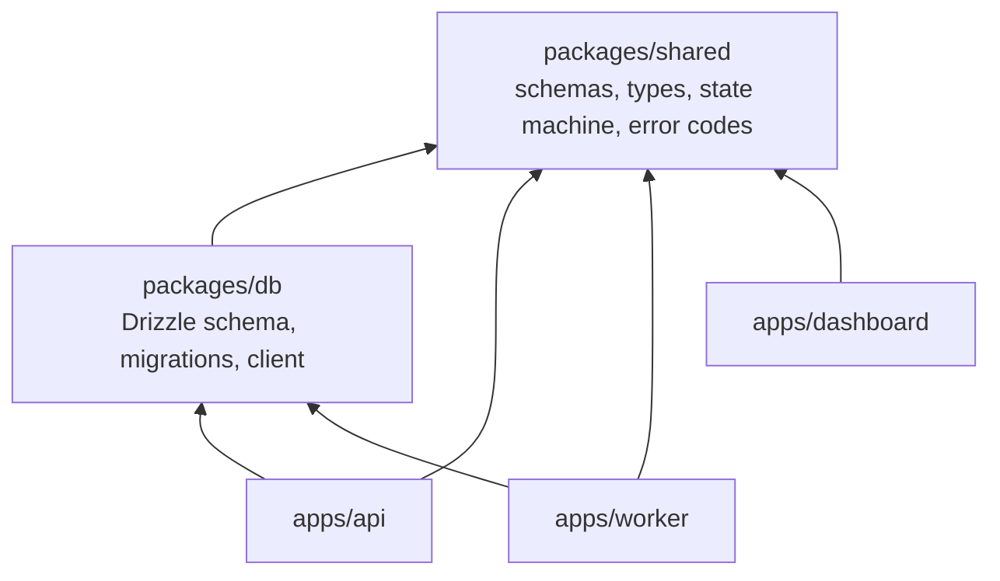
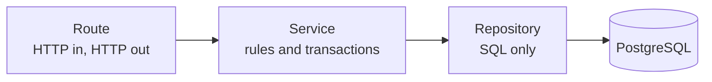
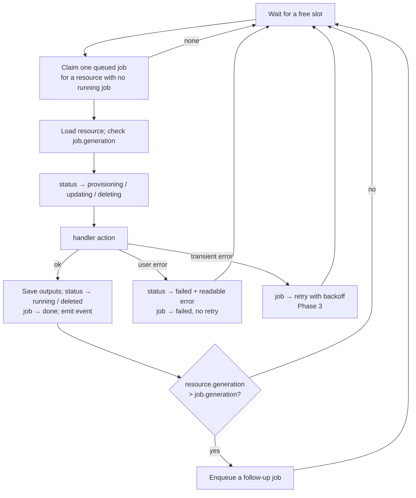

# Mini Cloud — Backend Architecture

| | |
|---|---|
| Status | Draft v1 |
| Last updated | 2026-11-17 |
| Covers | `apps/api`, `apps/worker`, `packages/shared`, `packages/db` |
| Related | [Architecture](ARCHITECTURE.md) · [Frontend](FRONTEND.md) · ADRs [0002](adr/0002-typescript-node-control-plane.md), [0004](adr/0004-terraform-provisioning.md), [0006](adr/0006-postgres-for-everything.md), [0008](adr/0008-generic-resources-table.md), [0010](adr/0010-fastify-zod-drizzle.md), [0011](adr/0011-same-origin-console-and-api.md) |

The backend is two programs that never call each other directly. They meet in the database.

- **API** (`apps/api`): answers HTTP requests. Validates, checks permissions, writes desired state and jobs, serves reads. It never touches Docker or Terraform.
- **Worker** (`apps/worker`): takes jobs from the database and makes reality match desired state, using Terraform and the Docker API.

---

## 1. Package dependencies



**Rules**

- `shared` depends on nothing but Zod. It must run in both Node and the browser.
- `dashboard` imports only `shared`. Never `db`, never server code.
- `api` and `worker` never import each other.

## 2. Shared package (`packages/shared`)

The single source of truth for what a resource *is*.

```
packages/shared/src/
├── index.ts
├── common/
│   ├── names.ts           resourceName schema (FR-6)
│   ├── pagination.ts      limit + cursor schemas, Page<T> type
│   └── ids.ts             UUID schema, shortId()
├── status.ts              ResourceStatus enum + canTransition(from, to)
├── errors.ts              ErrorCode enum + ApiErrorBody type (FR-31)
└── resource-types/
    ├── registry.ts        defineResourceType(), getResourceType(type)
    └── server.ts          serverSpec, serverOutputs, sizes (Phase 3)
```

### Resource type definition

Every service registers itself once. The API, worker and dashboard all read the same definition ([ADR-0008](adr/0008-generic-resources-table.md)).

```ts
// packages/shared/src/resource-types/server.ts
export const server = defineResourceType({
  type: "server",
  label: "Server",
  spec: z.object({
    image: z.enum(["nginx", "httpd", "whoami"]),
    port: z.number().int().min(1).max(65535),
  }),
  outputs: z.object({
    url: z.string().url(),
    containerId: z.string(),
  }),
  updatable: [],        // spec fields that can change without replacing the resource (Phase 3)
  actions: [],          // e.g. ["start", "stop", "restart"] in Phase 3
});
```

Adding a service = one new file here, one Terraform module, one worker handler, one dashboard feature folder.

### State machine

`canTransition(from, to)` encodes the diagram in [ARCHITECTURE §5](ARCHITECTURE.md#5-resource-model-and-state-machine). The API calls it before accepting a request (you can't delete a resource that is already `deleting`). The worker calls it before every status update. An illegal transition is a bug and throws.

## 3. API (`apps/api`)

### 3.1 Folder structure

```
apps/api/src/
├── main.ts                 Reads config, builds the app, listens, handles SIGTERM
├── app.ts                  buildApp(config): registers plugins and modules. Used by tests too.
├── config.ts               Zod schema for environment variables; fails fast at startup
├── plugins/
│   ├── db.ts               Creates the Drizzle client, decorates app.db, closes on shutdown
│   ├── request-id.ts       Reads or creates X-Request-Id, adds it to logs and the response
│   ├── error-handler.ts    Turns any thrown error into the FR-31 error body
│   ├── auth.ts             Phase 5: session cookie or API key → request.principal
│   ├── rate-limit.ts       Phase 5
│   └── events.ts           Phase 3: server-sent events hub
├── modules/
│   ├── health/
│   │   └── health.routes.ts         GET /healthz, GET /readyz
│   ├── resources/                    Generic lifecycle shared by every type
│   │   ├── resources.service.ts      create, list, get, update, delete, runAction
│   │   ├── resources.repo.ts         Drizzle queries on resources
│   │   └── resources.mapper.ts       DB row → API response shape
│   ├── jobs/
│   │   ├── jobs.routes.ts            GET /v1/jobs/:id, GET /v1/{type}/:id/jobs
│   │   └── jobs.repo.ts
│   └── servers/
│       └── servers.routes.ts         Thin routes that call resources.service with type "server"
└── lib/
    ├── errors.ts           AppError, NotFoundError, ConflictError, ValidationError, ForbiddenError
    ├── pagination.ts       Cursor encode/decode
    └── tx.ts               withTransaction(db, fn)
```

### 3.2 Layers

Each request passes through three layers. Each layer has one job and may only call the layer below it.



| Layer | Does | Never does |
|---|---|---|
| **Route** | Declares path, method and Zod schemas; reads `request.principal`; calls one service method; sets status code | SQL, business rules, try/catch for expected errors |
| **Service** | Validates `spec` against the resource type; checks the state machine and permissions; opens transactions; writes resource + job + audit event together | Knows about HTTP, status codes or `request` |
| **Repository** | Runs Drizzle queries and returns plain objects | Business rules, transactions it didn't receive |

Why this matters: when Phase 4 adds 6 services and Phase 5 adds permissions, each change lands in exactly one layer.

### 3.3 One request, in code

```ts
// modules/servers/servers.routes.ts
app.post("/v1/servers", {
  schema: { body: createServerBody, response: { 202: serverResponse } },
}, async (req, reply) => {
  const resource = await resources.create({ type: "server", ...req.body }, req.principal);
  return reply.code(202).send(toResponse(resource));
});
```

```ts
// modules/resources/resources.service.ts
async create(input, principal) {
  const def = getResourceType(input.type);
  const spec = def.spec.parse(input.spec);            // 400 if invalid
  return withTransaction(this.db, async (tx) => {
    const resource = await this.repo.insert(tx, { ...input, spec, status: "pending" });
    await this.jobs.enqueue(tx, { resourceId: resource.id, action: "create", generation: 1 });
    await this.audit.record(tx, principal, "resource.create", resource);   // Phase 5
    return resource;                                   // 409 if the unique index fires
  });
}
```

The resource and its job are written **in one transaction**. If either fails, neither exists. This is why the queue lives in Postgres ([ADR-0006](adr/0006-postgres-for-everything.md)).

### 3.4 Endpoints

JSON uses `camelCase`. All mutating endpoints return `202 Accepted` with the resource in its new status.

| Method | Path | Phase | Returns |
|---|---|---|---|
| `GET` | `/healthz` | 2 | `200` if the process is up |
| `GET` | `/readyz` | 2 | `200` if the database answers |
| `POST` | `/v1/servers` | 2 | `202` resource (`pending`) |
| `GET` | `/v1/servers` | 2 | `200` `{ items, nextCursor }` |
| `GET` | `/v1/servers/:id` | 2 | `200` resource |
| `DELETE` | `/v1/servers/:id` | 3 | `202` resource (`deleting`) |
| `PATCH` | `/v1/servers/:id` | 3 | `202` resource (`updating`) |
| `POST` | `/v1/servers/:id/actions/:action` | 3 | `202` resource (`starting`/`stopping`) |
| `GET` | `/v1/servers/:id/jobs` | 3 | `200` job list |
| `GET` | `/v1/jobs/:id` | 3 | `200` job with `logTail` |
| `GET` | `/v1/events` | 3 | Server-sent events stream |
| `*` | `/v1/{type}/...` | 4 | Same shape for every resource type, generated from the registry |
| `POST` | `/v1/auth/login`, `/logout`, `GET /v1/me` | 5 | Session cookie |
| `*` | `/v1/projects/:projectId/...` | 5 | Resource routes become project-scoped |

**Resource response shape**

```json
{
  "id": "7f3a9c2e-…",
  "type": "server",
  "name": "web-1",
  "status": "running",
  "spec": { "image": "nginx", "port": 80 },
  "outputs": { "url": "http://web-1.mc.localhost", "containerId": "a1b2…" },
  "error": null,
  "createdAt": "2026-11-17T10:00:00Z",
  "updatedAt": "2026-11-17T10:00:12Z"
}
```

### 3.5 Errors

Services throw typed errors. One error handler turns them into the FR-31 shape. Routes never build error responses by hand.

| Thrown | HTTP | `error.code` |
|---|---|---|
| Zod validation failure | 400 | `validation_failed` (field errors in `details`) |
| `NotFoundError` | 404 | `not_found` |
| `ConflictError` / unique violation | 409 | `name_taken` |
| Illegal state transition | 409 | `invalid_state` |
| `ForbiddenError` (Phase 5) | 403 | `forbidden` |
| Quota exceeded (Phase 5) | 422 | `quota_exceeded` |
| Rate limit (Phase 5) | 429 | `rate_limited` |
| Anything else | 500 | `internal` (details logged, never sent) |

### 3.6 Cross-cutting concerns

| Concern | How | Phase |
|---|---|---|
| Config | `config.ts` parses `process.env` with Zod once; the rest of the code receives a typed object | 2 |
| Logging | Pino; each request logger carries `requestId`; services log with `resourceId` | 2 |
| Validation | Zod on every body, param and query string via the Fastify Zod type provider | 2 |
| Graceful shutdown | On `SIGTERM`: stop accepting, finish in-flight requests, close the DB pool | 2 |
| Authentication | Session cookie (`HttpOnly`, `SameSite=Lax`) for the dashboard; `Authorization: Bearer mc_…` API keys for scripts | 5 |
| Authorization | `principal.can(action, resource)` called in the service layer, never in routes | 5 |
| CSRF | Same-origin + `SameSite=Lax` + a CSRF header on mutating requests | 5 |
| Live updates | Postgres `LISTEN/NOTIFY` on resource changes → SSE hub → browsers | 3 |
| Metrics | `/metrics` for Prometheus: request counts, latencies, job durations | 6 |

## 4. Worker (`apps/worker`)

### 4.1 Folder structure

```
apps/worker/src/
├── main.ts                    Reads config, starts the loop, handles SIGTERM
├── config.ts                  WORKER_CONCURRENCY, RUNS_DIR, TF_PLUGIN_CACHE_DIR, DATABASE_URL…
├── queue/
│   ├── job-queue.ts           Interface: claim(), complete(), fail(), heartbeat()
│   ├── pg-queue.ts            Phase 2: SELECT … FOR UPDATE SKIP LOCKED
│   └── pgboss-queue.ts        Phase 3: same interface on pg-boss
├── runner/
│   ├── job-runner.ts          Claims a job, loads the resource, picks the handler, records the result
│   └── status.ts              Status updates guarded by canTransition()
├── handlers/
│   ├── registry.ts            type → ResourceHandler
│   └── server.handler.ts      create / update / delete / actions for servers
├── terraform/
│   ├── workspace.ts           Prepares var/runs/<resource-id>/ and renders main.tf
│   ├── runner.ts              Runs init / apply / destroy / output; parses -json lines
│   └── templates/
│       └── module-call.tf.hbs Template: module block + variables from spec
└── docker/
    └── client.ts              dockerode wrapper: start, stop, restart, logs, stats (Phase 3)
```

### 4.2 The job loop



**Rules**

- **One job per resource at a time.** Two jobs on the same Terraform state would corrupt it. The claim query skips resources that already have a running job.
- **Generations.** Every change to a resource bumps `resources.generation`. A job remembers the generation it was created for. If the user changed the resource while the job ran, the worker queues a follow-up so the newest desired state always wins.
- **Concurrency.** `WORKER_CONCURRENCY` (default 2) jobs run at once, each in its own Terraform process.
- **Crash safety.** A job claimed but not finished within its timeout goes back to the queue. Terraform apply is idempotent, so running it again is safe.
- **Shutdown.** On `SIGTERM`, claim nothing new and wait for running jobs (up to a limit).

### 4.3 Handler interface

```ts
// handlers/registry.ts
export interface ResourceHandler {
  create(ctx: JobContext): Promise<Outputs>;
  update(ctx: JobContext): Promise<Outputs>;
  delete(ctx: JobContext): Promise<void>;
  action?(ctx: JobContext, name: string): Promise<void>;   // start, stop, restart…
}

interface JobContext {
  resource: Resource;
  job: Job;
  log: Logger;                      // child logger with resourceId and jobId
  terraform: TerraformRunner;
  docker: DockerClient;
  signal: AbortSignal;              // cancelled on shutdown or timeout
}
```

Most handlers are a few lines: create = render workspace + `terraform apply` + read outputs. Actions that Terraform does badly (start, stop, logs) use the Docker client.

### 4.4 Terraform runner

| Step | Command | Notes |
|---|---|---|
| Prepare | write `var/runs/<id>/main.tf` | Rendered from template, spec values escaped and already validated |
| Init | `terraform init -input=false` | Providers come from `TF_PLUGIN_CACHE_DIR` |
| Apply | `terraform apply -auto-approve -input=false -json` | Each JSON line is parsed: progress to logs, `diagnostic` lines to the error message |
| Outputs | `terraform output -json` | Validated with the type's `outputs` schema |
| Destroy | `terraform destroy -auto-approve -input=false -json` | Then delete the run folder |

The runner kills Terraform if the `AbortSignal` fires, and keeps the last 200 lines for `jobs.log_tail`.

### 4.5 Error classes

| Kind | Example | Worker behavior |
|---|---|---|
| **User error** | Image doesn't exist, port already used | `failed`, message shown to the user, no retry |
| **Transient** | Docker daemon restarting, DB connection lost | Retry with exponential backoff, up to 5 times (Phase 3) |
| **Bug** | Illegal state transition, outputs don't match schema | `failed` with a generic message; full details in logs |

## 5. Database package (`packages/db`)

```
packages/db/src/
├── schema/
│   ├── resources.ts
│   ├── jobs.ts
│   └── (Phase 5) users.ts, projects.ts, memberships.ts, api-keys.ts, audit-events.ts
├── client.ts          createDb(url) → Drizzle instance with a pool
├── migrate.ts         Runs pending migrations; used by `npm run db:migrate`
└── migrations/        Generated SQL files, committed and reviewed
```

- Migrations are generated by Drizzle Kit, **read by you**, and committed.
- Migrations only move forward. A mistake is fixed by a new migration.
- Phase 3 adds a trigger that runs `pg_notify('resource_changed', id)` after every update, for live events.

## 6. Testing strategy

| Level | What | Tool | Runs against |
|---|---|---|---|
| Unit | Schemas, state machine, pagination, template rendering | Vitest | Nothing external |
| API integration | Every endpoint: success and each error code | Vitest + `app.inject()` | Real Postgres (test database in Compose) |
| Worker integration | Job loop, locking, generations, failure handling | Vitest + a **fake** `TerraformRunner` | Real Postgres |
| Module | Each Terraform module applies and destroys cleanly | Shell script or Terratest-style Vitest test | Real Docker |
| End to end | Create from the dashboard, see it running | Playwright (Phase 3) | Full Compose stack |

The fake Terraform runner is why the runner is behind an interface: most worker tests run in milliseconds without touching Docker.

## 7. Configuration reference

| Variable | Used by | Example | Phase |
|---|---|---|---|
| `DATABASE_URL` | api, worker | `postgres://mc:mc@localhost:5432/minicloud` | 2 |
| `API_PORT` | api | `3000` | 2 |
| `BASE_DOMAIN` | worker | `mc.localhost` | 2 |
| `RUNS_DIR` | worker | `./var/runs` | 2 |
| `TF_PLUGIN_CACHE_DIR` | worker | `./var/tf-plugins` | 2 |
| `WORKER_CONCURRENCY` | worker | `2` | 2 |
| `LOG_LEVEL` | api, worker | `info` | 2 |
| `ALLOWED_IMAGES` | api, worker | `nginx,httpd,whoami` | 2 |
| `SESSION_SECRET` | api | (random, 32+ bytes) | 5 |
| `MASTER_KEY` | api, worker | (random, 32 bytes, base64) | 5 |

Every variable appears in `.env.example` with a safe example value.

## 8. Changes required by the console v3 design (2026-11-19)

The console was redesigned (cloud-console layout, 39 services, full journey from sign-up to account closure). The backend must change to support it. These items replace the older assumptions in this document where they conflict.

**Resource model**
- A **service registry**: each of the 39 services registers its type, Zod spec schema, Terraform module (or direct driver), allowed actions and status machine. Routes `/v1/{type}` are generated from it (already planned for Phase 4; now the core of the design).
- Every resource gets `deletion_protection` and a **soft-delete** state (`deleted` with `purge_at`, default 7 days, final snapshot for data).
- Resources link to each other (`links` table): app → database injects `DATABASE_URL`, function → queue trigger, gateway route → target.

**Deployments (new)**
- Tables `deployments` (resource, commit, image digest, status, steps, logs pointer, who) and `builds`.
- Pipeline as jobs: clone → build (sandboxed) → scan → push → pre-deploy → start + health check → switch traffic. Any failed step leaves the previous deployment serving.
- Rollback = redeploy a stored image digest with its settings; pauses auto-deploy.
- Git integration: GitHub App installations and signed webhooks; preview environments per pull request.

**Accounts and access**
- Hierarchy: organisation → projects. Account states: active → past due → suspended → closed → purged.
- Roles: Owner, Member, Viewer, Biller. MFA (passkey, TOTP) mandatory for owners; sessions list.
- API tokens with scopes (never above the user's role) and expiry; stored as hashes.
- Workload identity: short-lived credentials for apps instead of static keys.
- Audit log for every control-plane call, visible to the tenant.

**Operations**
- Quotas per project with increase requests; budgets and alerts; usage metering.
- Central logs per project (search, live tail, retention per plan).
- Security findings (image scans, posture rules) as a resource type.
- Object store: MinIO Community Edition is no longer maintained; choose its replacement in an ADR before Phase 4.

The console design covers every screen.
