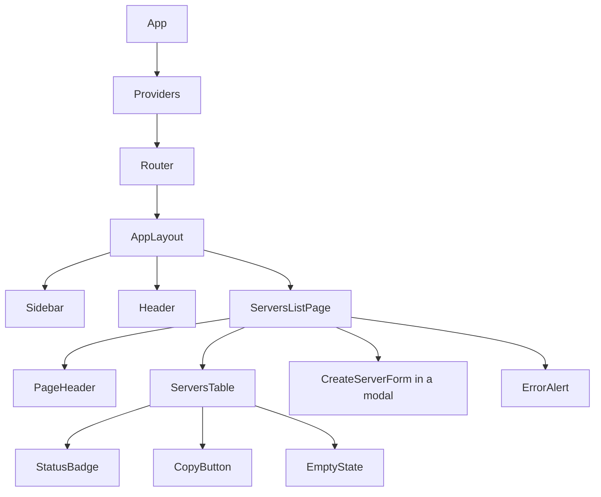
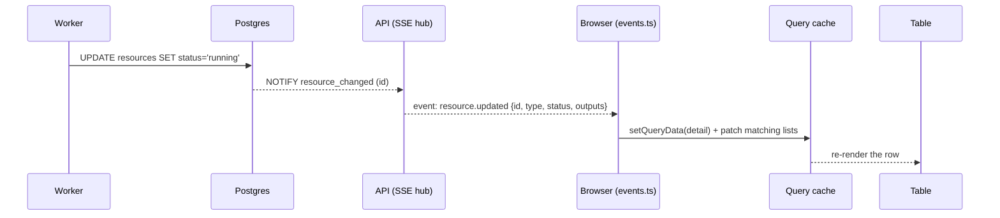

# Mini Cloud — Frontend Architecture

| | |
|---|---|
| Status | Draft v1 |
| Last updated | 2026-11-17 |
| Covers | `apps/dashboard` (the console) |
| Related | [Architecture](ARCHITECTURE.md) · [Backend](BACKEND.md) · [Spec](SPEC.md) · ADRs [0003](adr/0003-react-dashboard.md), [0011](adr/0011-same-origin-console-and-api.md) |

The dashboard is a **thin client**. It shows state and sends requests. Every rule (validation, permissions, what can change) lives in the backend or in `packages/shared`. If the dashboard disappeared, the API and CLI would still do everything.

---

## 1. Principles

1. **The server owns the truth.** Resource data lives in TanStack Query's cache, fetched from the API. No copy in a global store.
2. **Shared schemas, not duplicated rules.** Forms validate with the same Zod schemas the API uses.
3. **Feature folders.** Everything about servers lives in `features/servers/`. Adding a service adds one folder.
4. **Status is always visible.** Every resource shows its status as a badge, with a spinner while it changes.
5. **The URL is state.** Filters, sorting, pages and the selected tab live in the URL, so any view can be shared or bookmarked.
6. **Same origin as the API** ([ADR-0011](adr/0011-same-origin-console-and-api.md)). No CORS, simple cookies.

## 2. Folder structure

```
apps/dashboard/
├── index.html
├── vite.config.ts             Dev proxy: /v1 → http://localhost:3000
└── src/
    ├── main.tsx                Mounts <App />
    ├── app/
    │   ├── App.tsx             Providers + router
    │   ├── providers.tsx       MantineProvider, QueryClientProvider, Notifications
    │   ├── router.tsx          Route table (see §3)
    │   ├── query-client.ts     QueryClient defaults (retry, staleTime)
    │   └── layout/
    │       ├── AppLayout.tsx   Mantine AppShell: sidebar + header + <Outlet />
    │       ├── Sidebar.tsx     Service navigation, generated from the resource registry
    │       └── Header.tsx      Project switcher and user menu (Phase 5)
    ├── api/
    │   ├── client.ts           fetch wrapper: JSON, credentials, ApiError
    │   ├── errors.ts           ApiError class built from the FR-31 body
    │   ├── query-keys.ts       All query keys in one place
    │   └── events.ts           Phase 3: EventSource → cache updates
    ├── features/
    │   ├── servers/
    │   │   ├── api.ts                      useServers, useServer, useCreateServer, useDeleteServer…
    │   │   ├── pages/
    │   │   │   ├── ServersListPage.tsx
    │   │   │   └── ServerDetailPage.tsx    Phase 3
    │   │   └── components/
    │   │       ├── ServersTable.tsx
    │   │       ├── CreateServerForm.tsx
    │   │       └── ServerActions.tsx       Phase 3: start, stop, restart, delete
    │   ├── jobs/
    │   │   └── components/JobLog.tsx       Phase 3
    │   ├── auth/                           Phase 5: LoginPage, useMe
    │   └── (Phase 4) networks/, volumes/, databases/, buckets/, load-balancers/, dns/
    ├── components/             Shared, feature-agnostic UI
    │   ├── StatusBadge.tsx
    │   ├── ResourceTable.tsx   Phase 4: generic table driven by a column config
    │   ├── PageHeader.tsx
    │   ├── EmptyState.tsx
    │   ├── ErrorAlert.tsx
    │   ├── ConfirmDialog.tsx
    │   └── CopyButton.tsx
    ├── lib/
    │   ├── format.ts           Dates ("2 min ago"), bytes, durations
    │   └── use-url-state.ts    Read/write search params as typed state
    └── theme.ts                Mantine theme: colors, fonts, radius
```

**Import rules**

| Folder | May import from |
|---|---|
| `features/x` | `components`, `api`, `lib`, `@mini-cloud/shared` |
| `components` | `lib`, `@mini-cloud/shared` (never a feature) |
| `api` | `@mini-cloud/shared` |
| A feature | Never another feature's internals. Shared pieces move to `components`. |

## 3. Routes

| Path | Page | Phase |
|---|---|---|
| `/` | Redirects to `/servers` | 2 |
| `/servers` | Servers list + **Create server** button | 2 |
| `/servers/new` | Create form (a modal over the list) | 2 |
| `/servers/:id` | Detail: overview, outputs, jobs, logs | 3 |
| `/networks`, `/volumes`, `/databases`, `/buckets`, `/load-balancers`, `/dns` | One list + detail per service | 4 |
| `/login`, `/signup` | Authentication | 5 |
| `/p/:projectId/...` | All resource routes move under a project | 5 |
| `/p/:projectId/settings/members`, `/api-keys`, `/audit` | Project settings | 5 |
| `/p/:projectId/monitoring`, `/billing` | Graphs and invoices | 6 |
| `*` | Not found page | 2 |

Each route has an `errorElement`, so a crash in one page shows an error panel instead of a blank screen.

## 4. Component tree (Phase 2)



## 5. Data layer

### 5.1 Three kinds of state

| Kind | Example | Where it lives |
|---|---|---|
| **Server state** | The list of servers, a server's status | TanStack Query cache |
| **URL state** | Current filter, page cursor, selected tab | Search params (`use-url-state.ts`) |
| **UI state** | Is the modal open, form field values | `useState` / Mantine form, inside the component |

There is no global store (no Redux, no Zustand). If a real need appears, it gets an ADR.

### 5.2 API client

```ts
// api/client.ts
export async function api<T>(path: string, init?: RequestInit): Promise<T> {
  const res = await fetch(path, {
    ...init,
    credentials: "same-origin",
    headers: { "Content-Type": "application/json", ...init?.headers },
  });
  if (!res.ok) throw await ApiError.fromResponse(res);   // FR-31 body → typed error
  return res.status === 204 ? (undefined as T) : res.json();
}
```

Paths are relative (`/v1/servers`). In development Vite proxies them to the API; in production the same host serves both.

### 5.3 Query keys

All keys come from one file, so invalidation is never a guess:

```ts
export const qk = {
  resources: (type: string) => ["resources", type] as const,
  list: (type: string, params: ListParams) => ["resources", type, "list", params] as const,
  detail: (type: string, id: string) => ["resources", type, "detail", id] as const,
  jobs: (resourceId: string) => ["jobs", resourceId] as const,
  me: () => ["me"] as const,
};
```

### 5.4 Hooks per feature

```ts
// features/servers/api.ts
export function useServers(params: ListParams) {
  return useQuery({
    queryKey: qk.list("server", params),
    queryFn: () => api<Page<Server>>(`/v1/servers?${toQuery(params)}`),
    refetchInterval: (q) => (q.state.data?.items.some(isTransitional) ? 2000 : false),
  });
}

export function useCreateServer() {
  const qc = useQueryClient();
  return useMutation({
    mutationFn: (body: CreateServerBody) =>
      api<Server>("/v1/servers", { method: "POST", body: JSON.stringify(body) }),
    onSuccess: () => qc.invalidateQueries({ queryKey: qk.resources("server") }),
  });
}
```

`isTransitional` is true for `pending`, `provisioning`, `updating`, `deleting`, `starting` and `stopping`. Polling runs only while something is changing, then stops by itself.

### 5.5 Live updates (Phase 3)

Polling is replaced by server-sent events. One connection per tab:



If the connection drops, the browser reconnects and invalidates all resource queries once, so nothing is missed.

## 6. Forms

- Mantine `useForm` with a Zod resolver, using `createServerBody` from `@mini-cloud/shared`.
- Field errors appear as the user types, before any request is sent ([FR-22](SPEC.md#63-dashboard)).
- Server errors are mapped back to fields: `409 name_taken` → error under **Name**; `400 validation_failed` → each field in `details`.
- Submit button shows a loader and is disabled while the request runs. On success: close the modal, show a notification, highlight the new row.

## 7. UI system

| Element | Rule |
|---|---|
| Kit | Mantine components only. No second UI library. |
| Theme | Defined once in `theme.ts`: primary color, fonts, radius, light and dark mode. |
| Layout | `AppShell`: fixed sidebar of services (from the registry), header, content area with a max width. |
| Feedback | Mantine notifications for success and failure of actions; `ErrorAlert` for page-level errors. |
| Loading | Skeleton rows for tables, never a blank page. |
| Empty | `EmptyState` with one sentence and the create button. |
| Destructive actions | `ConfirmDialog` that asks the user to type the resource name before deleting. |
| Accessibility | Every icon button has an `aria-label`; status is never shown by color alone (badge has text). |

### Status badge

| Status | Color | Icon |
|---|---|---|
| `pending` | gray | clock |
| `provisioning`, `updating`, `starting`, `stopping`, `deleting` | blue | spinner |
| `running` | green | check |
| `stopped` | dark gray | square |
| `failed` | red | alert (error shown on hover and in the detail page) |

## 8. Authentication (Phase 5)

- The API sets an `HttpOnly`, `SameSite=Lax` session cookie at login. The dashboard never sees or stores a token: nothing in `localStorage`.
- `useMe()` loads the current user. A route guard sends visitors without a session to `/login`.
- A `401` from any request clears the cache and redirects to `/login`.
- The UI hides buttons the user's role can't use, but **the API still enforces it**. Hiding a button is convenience, not security.

## 9. Build and serving

| Stage | How the dashboard is served | How it reaches the API |
|---|---|---|
| Dev | `vite` dev server on `localhost:5173` | Vite proxy forwards `/v1` to `localhost:3000` |
| Compose (local and VPS) | `vite build` → static files in a small static-file container | Traefik routes `console.<domain>/` to the static files and `console.<domain>/v1` to the API |

Environment-specific values are not baked into the build; the app only uses relative paths.

## 10. Testing

| Level | What | Tool |
|---|---|---|
| Unit | `format.ts`, `isTransitional`, URL state helpers | Vitest |
| Component | `StatusBadge`, `CreateServerForm` (validation, server error mapping), `ServersTable` states (loading, empty, error, data) | Vitest + React Testing Library |
| API mocking | Fake API responses for component tests | MSW (Mock Service Worker) |
| End to end | Create a server and watch it reach `running` | Playwright, against the full Compose stack (Phase 3) |

## 11. Adding a service to the dashboard (Phase 4 onward)

1. The resource type already exists in `packages/shared` (backend work).
2. Create `features/<type>/api.ts` with hooks, using the generic `qk` keys.
3. Create the list page with `ResourceTable` and a column config.
4. Create the form using the type's Zod spec schema.
5. Add the route. The sidebar entry appears from the registry.
