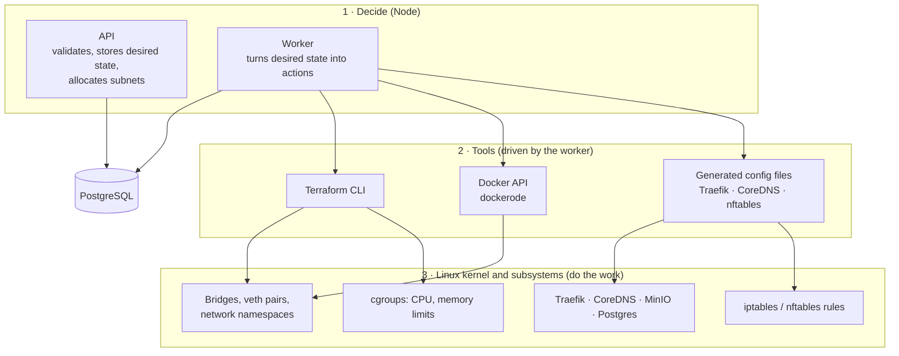
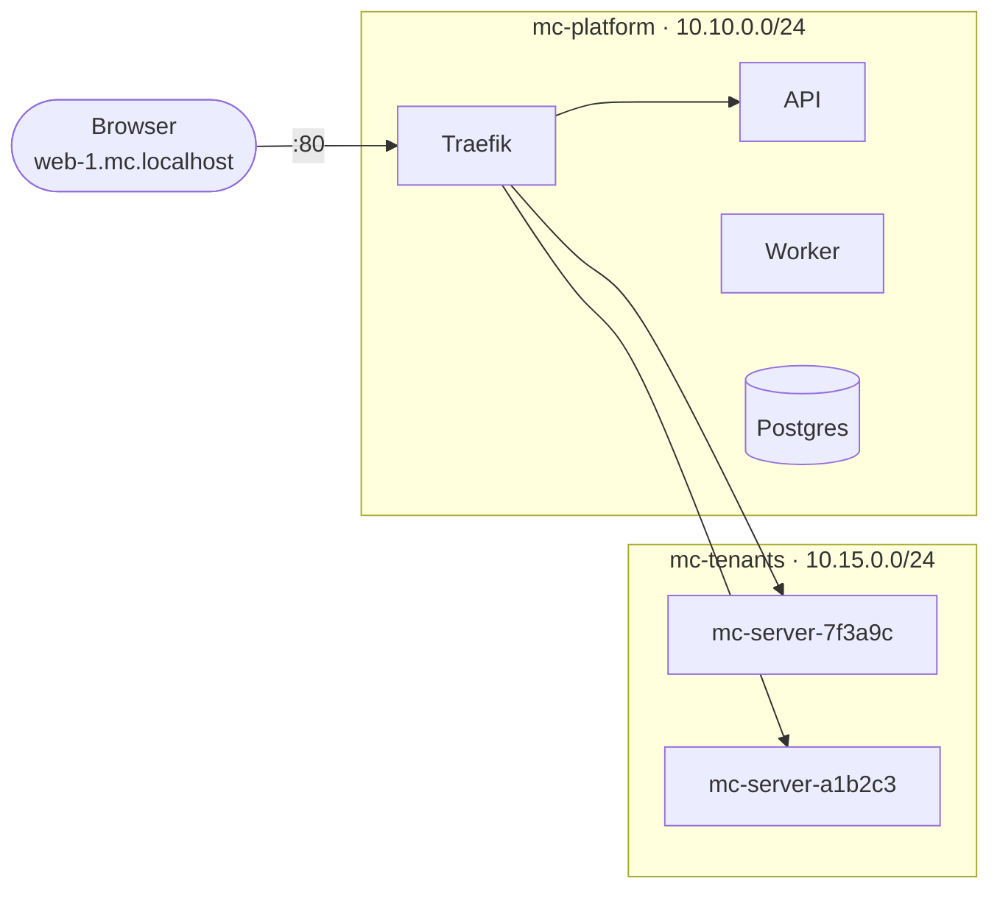
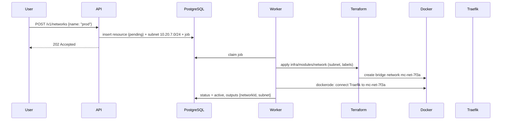
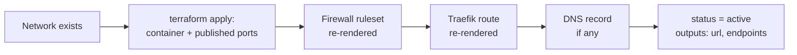
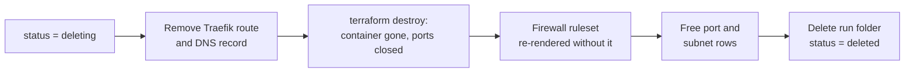

# Infrastructure and networking

| | |
|---|---|
| Covers | How the Node control plane drives the network, the infrastructure and every subsystem (Docker, Traefik, CoreDNS, MinIO, firewall, later VMs) |
| Related | [Architecture](ARCHITECTURE.md) · [Backend](BACKEND.md) · [Capacity](CAPACITY.md) · ADRs [0004](adr/0004-terraform-provisioning.md), [0005](adr/0005-docker-first-data-plane.md) |
| Status | Design. Not built yet. Parts marked with a phase number arrive in that phase. |

---

## 1. The one idea: Node decides, Linux does the networking

Node never moves a single network packet. It has no proxy, no DNS server and no firewall inside it. Those jobs belong to programs that are built for them and to the Linux kernel.



When a user creates a private network, this is what actually happens:

1. The **API** checks the request, picks a free subnet (for example `10.20.7.0/24`) and saves it in the database.
2. The **worker** runs Terraform, which asks Docker to create the network.
3. **Docker** asks the **kernel** to create a Linux bridge with that subnet and NAT rules.
4. From then on, packets flow through the kernel. Node isn't involved anymore.

That is also how AWS works: the control plane decides, and a separate data plane moves packets.

---

## 2. Three ways Node controls a subsystem

Every subsystem is controlled in one of three ways. Pick by the kind of change.

| Way | Use it for | Examples | Node code |
|---|---|---|---|
| **A. Terraform** | Long-lived things with a create/update/delete lifecycle | Server containers, project networks, volumes, buckets, database containers | `child_process.spawn("terraform", [...])` in `worker/terraform/` |
| **B. Direct API call** | Quick actions and reads with no lifecycle | Start, stop, restart, logs, stats, connect Traefik to a network | `dockerode` in `worker/docker/` |
| **C. Generated file + hot reload** | Config that the subsystem reads from disk and reloads by itself | Traefik routes and load balancers, DNS records, firewall rules | Render from the database, write the whole file atomically |

**Decision rule:** if it should still exist after a restart and be deleted later, use **A**. If it is a one-off action or a read, use **B**. If the subsystem already knows how to watch a file, use **C**.

---

## 3. Who owns what

There are two kinds of infrastructure, and they're managed differently.

| Layer | Examples | Created by | When |
|---|---|---|---|
| **The machine** | Ubuntu, Docker Engine, kernel settings, swap, host firewall | Manual setup at first, then a host config script (Phase 7, [CAPACITY §6](CAPACITY.md#6-host-configuration-as-code-phase-7)) | Rarely |
| **The platform itself** | `api`, `worker`, `postgres`, `traefik`, `minio`, `coredns`, `prometheus` containers; networks `mc-platform` and `mc-tenants` | **Docker Compose** (`docker-compose.yml`) | When you deploy |
| **Tenant resources** | Servers, project networks, volumes, buckets, databases | **Terraform, run by the worker** | Every time a user clicks |
| **Runtime actions** | Start/stop, logs, stats, attach Traefik to a network | **dockerode, from the worker** | Every time a user clicks |
| **Routes, DNS, firewall rules** | Traefik dynamic config, DNS zone, nftables ruleset | **Files written by the worker** | After every change |

Short version: **Compose runs the platform. Terraform runs the tenants. Node decides.**

Terraform never manages the platform's own containers. If it did, a bad tenant run could delete Traefik.

---

## 4. Subsystem map

| Subsystem | What it does | How Node controls it | Phase |
|---|---|---|---|
| **Docker Engine** | Runs containers, creates networks and volumes | A (Terraform `kreuzwerker/docker`) and B (dockerode) | 2 |
| **Docker networks** | Private networks; each one is a Linux bridge | A: `docker_network` resource | 2 shared, 4 per project |
| **Traefik** | Edge router: hostnames → containers, load balancing, TLS later | Phase 2: container labels set by Terraform. Phase 4: C (file provider) | 2 |
| **CoreDNS** | Internal names beyond what Docker gives for free | C: zone file + `reload` plugin | 4 |
| **MinIO** | Buckets and access keys | A (Terraform `aminueza/minio`) | 4 |
| **Postgres (tenant)** | Managed databases, one container per database | A (container + volume), B (`pg` client to create the user and database inside) | 4 |
| **Firewall** | Security-group rules per server | C: nftables ruleset, applied with `nft -f` | 4 (needs Docker Engine in WSL2), 7 on the VPS |
| **Prometheus + cAdvisor** | Metrics per container | C: scrape config; B: HTTP queries for graphs | 6 |
| **KVM / libvirt or Proxmox** | Real virtual machines | A (`dmacvicar/libvirt` or `bpg/proxmox`) through a host agent | 9 |

---

## 5. Network layout

### 5.1 Phase 2: one shared tenant network



- Traefik is the **only** container that publishes ports to the host (`80`, and the dashboard on `127.0.0.1:8080`).
- Postgres publishes `127.0.0.1:5432` in dev only, so you can open it with a database tool. Never on the VPS.
- Tenant containers publish **no** ports. They are reachable only through Traefik.
- Traefik is on both networks. Tenants are never on `mc-platform`.
- **Known gap in Phase 2:** all tenant servers share `mc-tenants`, so they can reach each other. That's acceptable while you are the only user. Phase 4 fixes it.

### 5.2 Phase 4: one private network per project

```mermaid
flowchart LR
    browser([Browser]) --> traefik
    subgraph platform["mc-platform"]
        traefik[Traefik]
        api[API] 
        worker[Worker]
    end
    subgraph pa["mc-net-a1b2 · 10.20.1.0/24 · project A"]
        a1[web] --> a2[(db)]
    end
    subgraph pb["mc-net-c3d4 · 10.20.2.0/24 · project B"]
        b1[web]
    end
    traefik --> a1
    traefik --> b1
    a1 -.x.- b1
```

- Each project gets its own Docker network. Servers in project A can't reach project B because they're on different bridges.
- After creating a project network, the worker connects Traefik to it with dockerode (Terraform doesn't manage Traefik, see §3).
- A database server can sit on an `internal: true` network: no route to the internet at all.
- Inside one project, Docker's built-in DNS (`127.0.0.11`) already resolves server names. So `web` can reach `db` by name with no extra work. CoreDNS is only needed for custom records and private zones.

### 5.3 Traffic flows

| Flow | Path | Allowed? |
|---|---|---|
| Browser → tenant server | Browser → host port 80 → Traefik → matches `Host(web-1.mc.localhost)` → container IP:port | Yes |
| Browser → dashboard/API | Browser → Traefik → `api` (same origin, [ADR-0011](adr/0011-same-origin-console-and-api.md)) | Yes |
| Server → server, same project | Direct over the project bridge, by name | Yes (firewall rules can narrow it) |
| Server → server, other project | Different bridges, no route | **No** |
| Server → internet | Bridge → NAT on the host → out | Yes, unless the network is `internal` |
| Server → API, Postgres, worker | Tenants are not on `mc-platform` | **No** |
| Server → Docker socket | Never mounted into tenant containers | **No** |

### 5.4 Later phases

| Phase | What changes in the network |
|---|---|
| 7 — VPS | A public IP. Host firewall allows only 22, 80, 443. **Gotcha:** `ufw` does not filter ports that Docker publishes, because Docker adds its own iptables rules first. Rules for container traffic go in the `DOCKER-USER` chain. Check the Docker docs for your exact version, since newer versions add nftables support. Wildcard DNS `*.yourdomain` → VPS, HTTPS by Traefik with Let's Encrypt. |
| 9 — Real VMs | VMs attach to Linux bridges or libvirt networks instead of Docker networks. Each compute host runs a small **Node host agent** that applies network and firewall changes locally, because the worker can't reach another machine's kernel. |
| 10 — Several hosts | A project network that spans hosts needs an overlay (VXLAN) or routing between hosts. This is how VPCs work in real clouds, and it's a good Phase 10 topic. |

---

## 6. Address plan (IPAM)

Write the IP ranges down before you create anything. Overlapping ranges are the most common networking bug.

| Range | Used for | Set in |
|---|---|---|
| `10.10.0.0/24` | `mc-platform` | `docker-compose.yml` |
| `10.15.0.0/24` | `mc-tenants` (Phase 2–3) | `docker-compose.yml` |
| `10.20.0.0/16` | Project networks, one `/24` each → 254 projects | Allocated by the API (below) |
| `10.200.0.0/16` | Docker's default pool for anything not planned | Docker `daemon.json` → `default-address-pools` |

Check these don't overlap with your home network (often `192.168.x.x`), with WSL's own range (`172.x`), or later with your VPS provider's private network.

**Allocation is desired state, so the API does it** in the same transaction that creates the network resource:

```sql
-- One row per allocated /24. The unique index makes double allocation impossible.
create table subnets (
  idx         smallint primary key check (idx between 1 and 254),  -- 10.20.<idx>.0/24
  resource_id uuid not null unique references resources(id) on delete cascade
);
```

```ts
// apps/api/src/modules/networks/subnet-allocator.ts
export async function allocateSubnet(tx: Tx, resourceId: string): Promise<string> {
  const free = await tx.execute(sql`
    select g.idx from generate_series(1, 254) as g(idx)
    where not exists (select 1 from subnets s where s.idx = g.idx)
    order by g.idx limit 1
  `);
  if (free.rows.length === 0) throw new ConflictError("no_free_subnet");
  const idx = free.rows[0].idx as number;
  await tx.insert(subnets).values({ idx, resourceId }); // unique PK: a race fails here, the caller retries
  return `10.20.${idx}.0/24`;
}
```

The subnet goes into the resource's `spec`. The worker passes it to Terraform. The worker never chooses addresses itself.

---

## 7. One network, end to end (Phase 4)



The Terraform module:

```hcl
# infra/modules/network/main.tf
resource "docker_network" "this" {
  name     = "mc-net-${var.short_id}"
  driver   = "bridge"
  internal = var.internal

  ipam_config {
    subnet = var.subnet          # chosen by the API, never by Terraform
  }

  labels {
    label = "mc.resource-id"     # every object carries its owner: orphans are easy to find
    value = var.resource_id
  }
}

output "network_id" { value = docker_network.this.id }
```

The direct API step in the worker:

```ts
// apps/worker/src/docker/networks.ts
export async function attachEdge(docker: Docker, networkName: string) {
  const net = docker.getNetwork(networkName);
  const info = await net.inspect();
  const already = Object.values(info.Containers ?? {}).some((c: any) => c.Name === "mc-traefik");
  if (!already) await net.connect({ Container: "mc-traefik" }); // idempotent: safe to run twice
}
```

Delete goes in reverse: disconnect Traefik, `terraform destroy`, free the subnet row.

---

## 8. Generated config files (way C)

Traefik (Phase 4+), CoreDNS and the firewall all read a file. The worker writes those files with three rules:

1. **Render the whole file from the database, never patch it.** Each run produces the full truth, so a lost or broken file fixes itself on the next change.
2. **Write atomically:** write to a temporary file, then rename it. The subsystem watches the file and must never read half of it.
3. **Never edit by hand** ([ARCHITECTURE §7](ARCHITECTURE.md#7-configuration)).

```ts
// apps/worker/src/lib/atomic-write.ts
import { writeFile, rename } from "node:fs/promises";
export async function atomicWrite(path: string, content: string) {
  const tmp = `${path}.tmp-${process.pid}`;
  await writeFile(tmp, content, { mode: 0o640 });
  await rename(tmp, path); // rename is atomic on the same filesystem
}
```

### Traefik (load balancers, Phase 4)

```ts
// apps/worker/src/edge/render-traefik.ts
export function renderTraefik(lbs: LoadBalancer[]): string {
  const http = { routers: {} as any, services: {} as any };
  for (const lb of lbs) {
    http.routers[lb.shortId] = { rule: `Host(\`${lb.hostname}\`)`, service: lb.shortId };
    http.services[lb.shortId] = {
      loadBalancer: {
        servers: lb.targets.map((t) => ({ url: `http://${t.ip}:${t.port}` })),
        healthCheck: { path: lb.healthPath, interval: "10s" },
      },
    };
  }
  return YAML.stringify({ http });
}
// then: atomicWrite("/etc/mc/traefik/dynamic/tenants.yml", renderTraefik(await repo.allActiveLbs()))
```

Traefik is started with the file provider watching `/etc/mc/traefik/dynamic/`. It picks up the new file within a second, with no restart.

### CoreDNS (Phase 4)

The worker renders a zone file `mc.internal` from the database. CoreDNS's `file` plugin reloads it when the serial number changes. Anything not in the zone is forwarded to normal DNS.

### Firewall (security groups, Phase 4/7)

The worker renders one nftables file from all firewall rules in the database, starting with `flush table inet mc`, and applies it with `nft -f`. One file means the whole ruleset changes at once: there's never a moment with half the rules.

This needs access to the kernel where the containers run. With Docker Desktop, containers run inside Docker Desktop's own VM, not in your Ubuntu, so rules written in Ubuntu don't affect them. That's the open question in [ARCHITECTURE §12](ARCHITECTURE.md#12-open-questions): switch to Docker Engine inside WSL2 before Phase 4's firewall epic.

---

## 9. Safety rules for any Node code that touches infrastructure

| Rule | Why |
|---|---|
| Only the worker (and later the host agent) touches infrastructure. The API never does. | The worker is effectively root. Keep it away from the internet. |
| Run tools with `spawn`/`execFile` and an **argument array**. Never `exec` with a string, never `shell: true`. | A server named `x; rm -rf /` must stay a harmless string. |
| Pass values to Terraform as a JSON var file, never by pasting them into HCL text. | Same reason: data stays data. |
| Validate the spec with Zod again in the worker before using it. | The database could hold a bad row. |
| Images come from an allow-list. | Users can't pull arbitrary images in early phases. |
| Every object gets the label `mc.resource-id`. | You can always find and delete what a resource left behind. |
| Every operation is idempotent (check, then act). | Jobs are retried after crashes. |
| Tenant containers: `cap_drop = ["ALL"]`, `no-new-privileges`, memory/CPU/PID limits, no socket, not on `mc-platform`. | Untrusted code. |

### The Phase 2 exception: Traefik and the Docker socket

In Phase 2, Traefik uses its **Docker provider** (it reads container labels), so it needs the Docker socket. Mounting the socket read-only (`:ro`) does **not** make that safe: the socket is an API, and read-only on the file doesn't restrict the API calls. Anyone who takes over Traefik controls Docker.

That's acceptable on your PC for Phase 2 only. Phase 4 switches Traefik to the file provider (§8) and removes the socket from Traefik, so the worker is again the only component with Docker access. Never put Traefik with a socket on the VPS.

---

## 10. Where this lives in the code

Additions to the worker tree in [BACKEND §4.1](BACKEND.md#41-folder-structure):

```
apps/worker/src/
├── terraform/           A · runs the Terraform CLI           (Phase 2)
├── docker/              B · dockerode: actions, attachEdge   (Phase 2–3)
├── edge/                C · renders Traefik dynamic config   (Phase 4)
├── dns/                 C · renders the CoreDNS zone          (Phase 4)
├── firewall/            C · renders the nftables ruleset      (Phase 4/7)
└── lib/atomic-write.ts
apps/api/src/modules/networks/subnet-allocator.ts              (Phase 4)
infra/modules/network/                                         (Phase 4)
infra/platform/traefik/  static config, dynamic/ directory     (Phase 2)
infra/platform/coredns/  Corefile                              (Phase 4)
```

---

## 11. Prototype before automating

| Step | Manual prototype |
|---|---|
| Phase 2 | Traefik routes a hostname to a container |
| Phase 4 | Write one Traefik file by hand and one nftables file by hand before the worker generates them |

Rule from the README: prototype it manually first, then automate it.

---

## 12. Exposing, opening, closing and destroying

### 12.1 Four separate switches

Making a server reachable takes four separate things. Each one is a different subsystem, and each has to be undone on delete.

| Switch | Question it answers | Subsystem | Real cloud equivalent |
|---|---|---|---|
| **Expose** | Is there a path from outside to this server? | Traefik route (HTTP) or a published host port (TCP/UDP) | Load balancer listener, public IP |
| **Open** | Is traffic on that path allowed? | Firewall rules (nftables) | Security group, network security group |
| **Name** | What name points to it? | Traefik hostname, CoreDNS, public DNS | Route 53, Azure DNS |
| **Network** | Which private network is it on? | Docker network (Linux bridge) | VPC / VNet and subnet |

A server can be exposed but closed: the path exists, the firewall drops the traffic. That's normal, and it's how you'd temporarily block traffic without deleting anything.

### 12.2 Expose: two kinds

**HTTP (default, Phase 2).** The server gets `http://<name>.mc.localhost`, later `https://<name>.mc.yourdomain`. No host port is opened for it. All servers share Traefik's port 80/443, and Traefik picks the server by the `Host` header. Thousands of servers need zero extra ports.

**TCP/UDP (Phase 4).** For things that aren't HTTP (a database, SSH, a game server), the platform publishes a host port taken from a pool, `30000–32767` (the same range Kubernetes uses for NodePorts). The user gets `mc.localhost:30042`.

Ports are allocated by the API the same way subnets are (§6): desired state, unique in the database.

```sql
create table port_allocations (
  host_id     uuid not null references hosts(id),          -- hosts table from CAPACITY §5
  port        int  not null check (port between 30000 and 32767),
  protocol    text not null check (protocol in ('tcp', 'udp')),
  resource_id uuid not null references resources(id) on delete cascade,
  primary key (host_id, port, protocol)                     -- two servers can never get the same port
);
```

The server spec grows an `expose` block:

```ts
// packages/shared/src/resource-types/server.ts (Phase 4)
expose: z.object({
  http: z.object({ port: z.number().int().min(1).max(65535) }).optional(),
  tcp: z.array(z.object({
    port: z.number().int().min(1).max(65535),              // port inside the container
    protocol: z.enum(["tcp", "udp"]).default("tcp"),
  })).max(5).default([]),
}),
// outputs: { url?: string, endpoints: [{ containerPort, hostPort, protocol }] }
```

The Terraform module publishes them:

```hcl
dynamic "ports" {
  for_each = var.tcp_ports      # [{ internal = 5432, external = 30042, protocol = "tcp" }]
  content {
    internal = ports.value.internal
    external = ports.value.external
    protocol = ports.value.protocol
    ip       = var.bind_ip      # 127.0.0.1 on your PC, the public IP on the VPS
  }
}
```

**Gotcha:** Docker can't add or remove a port on a running container. Changing TCP ports makes Terraform **replace** the container, which means a few seconds of downtime. The dashboard must warn before saving. Changing the HTTP route doesn't recreate anything; it only rewrites the Traefik file.

### 12.3 Open and close: firewall rules (Phase 4)

Firewall rules are their own resource type, attached to servers, like AWS security groups.

```ts
// POST /v1/firewalls
{ name: "db-access", servers: ["srv_7f3a"],
  ingress: [{ protocol: "tcp", port: 5432, from: "203.0.113.0/24" }] }
```

| Traffic | Default |
|---|---|
| Inbound from the same project (and Traefik on that network) | **Allowed** |
| Inbound from anywhere else | **Denied** unless a rule opens it |
| Outbound | Allowed |

- **Open a port:** add an ingress rule → job → the worker re-renders the whole ruleset from the database → `nft -f`.
- **Close a port:** delete the rule → same job, same full re-render. The rule simply isn't in the new file.

A sketch of the generated ruleset. Check it by hand in Phase 4, because Docker's own rules and nftables priorities interact:

```
table inet mc
flush table inet mc
table inet mc {
  chain forward {
    type filter hook forward priority -1; policy accept;   # runs before Docker's rules
    ct state established,related accept
    # server srv_7f3a (10.20.1.5)
    ip daddr 10.20.1.5 ip saddr 10.20.1.0/24 accept                    # same project + Traefik
    ip daddr 10.20.1.5 tcp dport 5432 ip saddr 203.0.113.0/24 accept   # firewall db-access
    ip daddr 10.20.1.5 drop                                             # everything else
  }
}
```

After Docker translates a published port, the packet's destination is the container's IP and **container** port, so rules use `10.20.1.5:5432`, not the host port `30042`.

### 12.4 Name: DNS

| Name | Example | How it works | Phase |
|---|---|---|---|
| Local public name | `web-1.mc.localhost` | Browsers send `*.localhost` to 127.0.0.1 by themselves. No DNS server. | 2 |
| Internal name, same project | `db` | Docker's built-in DNS on each network | 2 |
| Internal name, full | `db.a1b2.mc.internal` | CoreDNS zone rendered by the worker | 4 |
| Public name on the VPS | `web-1.mc.yourdomain` | **One** wildcard record `*.mc.yourdomain → VPS IP`, set once at your DNS provider. Creating a server changes no DNS: Traefik routes by name. | 7 |
| User's own domain | `shop.example.com` | The user adds a CNAME to `web-1.mc.yourdomain` and a TXT record to prove ownership. The worker checks the TXT and adds the hostname to the Traefik route, and Traefik gets a Let's Encrypt certificate. | 7 |
| DNS zones as a service | records the user manages | A `dns_record` resource type rendered into CoreDNS | 4+ |

The wildcard is the key trick: public DNS is configured once, and every new server is reachable immediately.

### 12.5 Create and destroy, in order

**Create** (worker, one job):



The route is added **last**, after the container is up and the firewall allows Traefik, so nobody hits a half-built server.

**Destroy** goes in reverse:



| Step | Why this order |
|---|---|
| Route first | Users get a clean 404 instead of timeouts while the container stops |
| Free ports **after** `destroy` succeeds | A port must never go to a new server while the old container still holds it |
| A failed step stops the job | The resource goes to `error`, keeps its allocations, and the job can be retried; every step is idempotent |
| Sweep orphans | A periodic check lists Docker objects with label `mc.resource-id` whose resource is `deleted` or missing, and removes them |

### 12.6 What arrives when

| Phase | Expose | Open / close | Name | Destroy |
|---|---|---|---|---|
| 2 | HTTP via Traefik labels | No firewall yet | `*.mc.localhost` | Basic (FR-13) |
| 3 | — | — | — | Full ordered delete, orphan sweep |
| 4 | TCP/UDP from the port pool; HTTP via the file provider | Firewall resource, nftables | Docker DNS + CoreDNS `mc.internal` | Includes ports, rules, DNS |
| 7 | HTTPS on 443 | Host firewall 22/80/443 + container rules | Wildcard + custom domains | Same |
